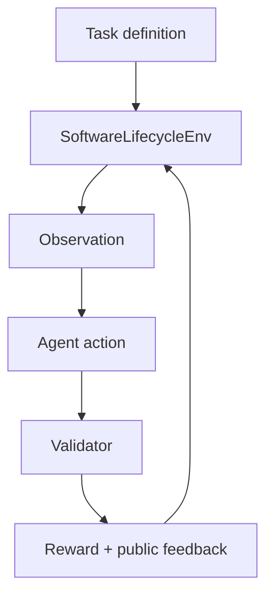

# Software Lifecycle Env

[](LICENSE)


Deterministic benchmark environment for evaluating AI agents on realistic software engineering workflows: testing, debugging, and safe maintenance.

The environment is intentionally small enough to run locally, but each task is designed like real engineering work: agents must inspect tests, logs, configs, notes, contracts, and source files before applying a fix.

## What It Evaluates

| Task | Workflow | What the Agent Must Do |
|---|---|---|
| `task_easy_testing` | Testing diagnosis | Trace a failing CI preview URL contract from tests/logs to the slug builder |
| `task_medium_debugging` | Root-cause debugging | Fix an API amount-formatting bug across endpoint, presenter, helper, and config layers |
| `task_hard_maintenance` | Safe maintenance | Refactor duplicated display-name cleanup into shared logic without breaking API/export contracts |

## Why It Exists

Many coding benchmarks reward agents for patching a visible example. Real software work is messier:

- the first failing test is often only a symptom
- logs and configuration matter
- behavior must hold across visible and hidden cases
- maintenance work should improve structure without breaking consumers
- agents should run validation before final submission

This benchmark tests those habits directly.

## Core Features

- Typed observation and action models with Pydantic
- Deterministic task state and reward scoring
- Hidden regression checks with public failure counts
- Anti-gaming checks for constant-return and visible-case-only patches
- Workflow-aware rewards for inspecting the right context before patching
- FastAPI server wrapper for hosted evaluation
- Local quality script with reference solve paths and scripted cheat attempts

## Action Space

| Action | Purpose |
|---|---|
| `inspect_file` | Read a file from the in-memory task repository |
| `apply_patch` | Replace one target file with new content |
| `run_tests` | Run deterministic visible/hidden validation |
| `submit` | End the episode and receive final score |

## Architecture



## Project Structure

```text
env/
  environment.py     # reset/step/state environment loop
  models.py          # Pydantic action, observation, reward, and step models
  tasks.py           # deterministic task repositories and task metadata
  validation.py      # visible, hidden, and integrity validation
  graders.py         # reward and final scoring helpers
server/
  app.py             # FastAPI wrapper
scripts/
  check_benchmark_quality.py
  diagnose_strict_bounds.py
BENCHMARK_REPORT.md # reproducible quality evidence
inference.py        # optional LLM runner using HF/OpenAI-compatible endpoint
```

## Quickstart

```bash
git clone https://github.com/Build4mBottom/software-lifecycle-env.git
cd software-lifecycle-env
python -m venv .venv
source .venv/bin/activate
pip install -r requirements.txt
```

Windows PowerShell:

```powershell
python -m venv .venv
.\.venv\Scripts\Activate.ps1
pip install -r requirements.txt
```

Run the local benchmark quality check:

```bash
python scripts/check_benchmark_quality.py
```

Run the API server:

```bash
uvicorn server.app:app --host 0.0.0.0 --port 7860
```

## Optional LLM Runner

`inference.py` can drive an OpenAI-compatible model endpoint through each task.

Required environment variables:

```text
HF_TOKEN       # API token for the configured endpoint
API_BASE_URL   # optional, defaults to Hugging Face router
MODEL_NAME     # optional, defaults to a small instruct model
```

Run:

```bash
python inference.py
```

No token is stored in this repository.

## Verification Evidence

The quality script checks:

- initial validator state
- scripted cheat attempts
- strong reference solve paths
- strict reward bounds
- hidden-check privacy behavior

Summary from `BENCHMARK_REPORT.md`:

| Task | Initial Overall | Scripted Cheat | Strong Solve |
|---|---:|---:|---:|
| `task_easy_testing` | `0.43` | `0.39` | `0.99` |
| `task_medium_debugging` | `0.30` | `0.32` | `0.99` |
| `task_hard_maintenance` | `0.44` | `0.41` | `0.99` |

See [`BENCHMARK_REPORT.md`](BENCHMARK_REPORT.md) for detailed task evidence.

## What This Demonstrates

- Python backend/package structure
- FastAPI service wrapping
- Agent evaluation design
- Deterministic validation and scoring
- Test/debug/refactor workflow modeling
- Safety-aware benchmark design against overfitting and shortcut patches

## Contributing

Contributions are welcome for new task designs, validation improvements, documentation, and examples.

Start with [`CONTRIBUTING.md`](CONTRIBUTING.md) and [`ROADMAP.md`](ROADMAP.md).

## Status

Prototype benchmark environment. Built as public proof of applied AI evaluation, Python architecture, and software-engineering workflow design.

## License

MIT
